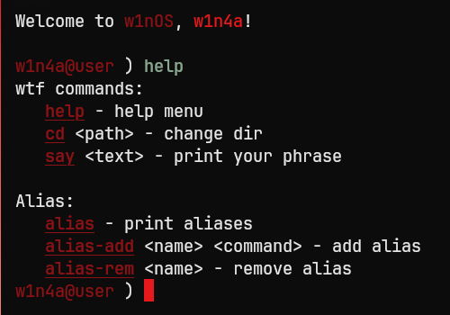

# wtf (for w1nOS)

**wtf** — **W**1nOS **T**erminal **F**ocused *(or what the fuck)*

A simple shell written in Rust, built exclusively for **w1nOS**.

### Shell-Commands:

#### Core
- `help` — show available commands
- `cd <path>` — change directory
- `say <text>` — print a phrase to the terminal

#### Aliases
- `alias` — list all active aliases
- `alias-add <name> <command>` — add a new alias
- `alias-rem <name>` — remove an existing alias

### License:
Project loves **[GNU GPL-3.0](LICENSE)**
